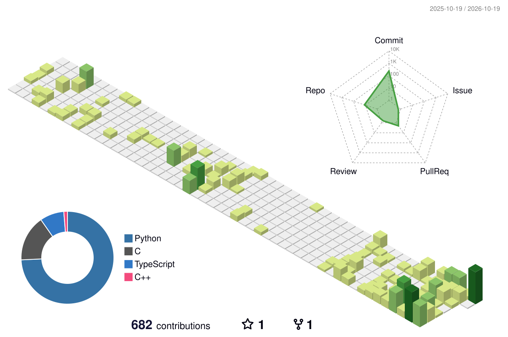

<h1 align="center">Aurindum Banerjee</h1>

  CS undergrad at IIT Jodhpur, building systems and ML software that is tested and measured.

  <a href="https://aurindumbanerjee.vercel.app/">Portfolio</a> ·
  <a href="https://www.linkedin.com/in/aurindum-banerjee">LinkedIn</a> ·
  <a href="mailto:banerjeeaurindum@gmail.com">Email</a>

---

## Projects

| Project | What it is | Result |
|---|---|---|
| [**Delphion**](https://github.com/AurindumBanerjee/Delphion) | RAG over PDFs with cited answers: hybrid BM25 + dense search, reranking and streaming (Python, Gradio) | On a 42-question benchmark over three books, hit@1 rose from 0.45 to 0.88 and MRR@5 from 0.58 to 0.92 |
| [**Aggregate-Queries-Optimiser**](https://github.com/AurindumBanerjee/Aggregate-Queries-Optimiser) | Small database engine in C++20: B+ tree, WAL with crash recovery, SQL layer, aggregate indexes | About 100× faster than SQLite's covering index on range aggregates at 1% selectivity (1M rows); crash-tested and checked by CI with sanitizers |
| [**InkWell**](https://github.com/AurindumBanerjee/InkWell) | Real-time collaborative markdown editor (TypeScript, Yjs, Postgres) | Two-user convergence verified by property tests and Playwright end-to-end tests |
| [**Script-Identifier**](https://github.com/AurindumBanerjee/Script-Identifier) | Identifies the script of scene text in Indian languages, comparing handcrafted and deep features across classical classifiers (Python, FastAPI, Next.js) | Team project; I contributed most of the code |

## Skills

**Languages:** C · C++ · Python · TypeScript · HTML

**ML:**
PyTorch · TensorFlow · OpenCV · NumPy · Pandas · Matplotlib · Jupyter

**Systems and tools:**
Linux · Git · Docker · GitHub Actions · PostgreSQL · MySQL · Arduino · VS Code

  
  
  
  
  
  &nbsp;|&nbsp;
  
  
  
  
  
  
  
  &nbsp;|&nbsp;
  
  
  
  
  
  
  
  

---

